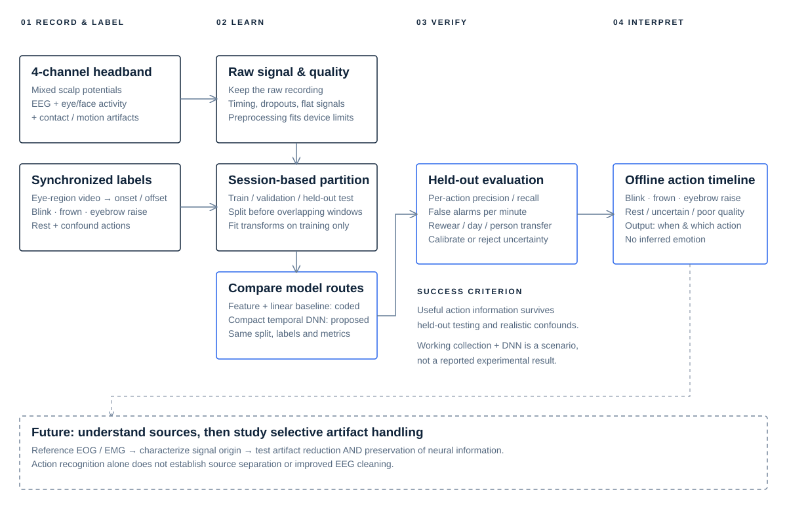

<div align="center">

# FACET

### Rethinking EEG artifacts as eye-region action signals

Four-channel wearable EEG · Offline action detection · Compact temporal learning

[Overview](#-overview) · [Pipeline](#-technical-route) · [Models](#-models) · [Scenarios](#-scenarios) · [Setup](#-setup-windows) · [Training](#-training--replay) · [Roadmap](#-roadmap)

</div>

---

## ✨ Overview

FACET explores whether signals conventionally treated as artifacts in EEG can provide useful information about **blinks, frowns and eyebrow raises**. Using an existing four-channel headband, the project pairs mixed electrical recordings with synchronized movement annotations and learns a compact action detector. Its longer-term goal is to characterize these components and investigate selective artifact handling that preserves neural information.

- **Reuse existing hardware** — start with a four-channel EEG headband rather than a dedicated facial EMG array.
- **Keep the raw mixture** — preserve eye/face-related activity before conventional artifact rejection.
- **Learn observable actions** — movement labels describe what the wearer does; they are not emotion labels.
- **Evaluate transfer** — measure performance across sessions, rewearing, days and participants.
- **Separate detection from source claims** — useful predictions do not, by themselves, establish pure EMG recovery or improved EEG cleaning.

> **Status:** An offline feature-based baseline, synthetic-data generator and replay pipeline are implemented. Headband acquisition, real-recording performance and the DNN route remain to be validated. The diagram describes the intended working system, not reported experimental results.

## 🔬 Technical route



| Stage | Technical route | Output / evidence |
| --- | --- | --- |
| Acquisition | Capture four-channel raw recordings on Windows; record device timing, units, reference and internal filtering | Continuous sessions with documented hardware settings |
| Annotation | Synchronize eye-region video and label actual movement onset/offset | Blink, frown, eyebrow raise and rest labels; confound trials |
| Quality control | Validate timestamps and finite values; reject flat windows; retain raw data | Usable windows and explicit rejection records |
| Preprocessing | Apply device-appropriate filtering; partition sessions before creating overlapping windows; fit learned transforms on training data only | Consistent training and replay inputs |
| Learning | Compare the implemented feature-based classifier with a proposed compact temporal DNN | Action scores per window |
| Evaluation | Hold out complete sessions; extend to rewear/day/participant splits | Per-action precision, recall and F1; confusion matrix; planned event-level false-alarm evaluation |
| Offline inference | Replay a recording with fixed model and preprocessing settings | Timestamped window predictions; quality failures marked `unknown` |
| Source research | Add reference EOG/EMG and controlled confounds; later assess artifact reduction and neural preservation separately | Physiological interpretation and cleaning evidence beyond classification |

Video serves as an **annotation/reference stream** in the initial design; it is not a required input to the action classifier. FPV/VLM and emotion recognition are outside the current scope.

## 🧠 Models

| Route | Input → model | Purpose | Status |
| --- | --- | --- | --- |
| Feature baseline | Four-channel windows → 32 temporal/spectral features → standardization → class-balanced logistic regression | Interpretable starting point and comparator | Implemented |
| Compact 1D CNN | Four-channel windows → temporal convolutions → pooling → action head | Learn local waveform patterns | Proposed first DNN candidate |
| CNN + GRU | Convolutional features → recurrent temporal context → action head | Investigate whether temporal context helps | Optional extension; not implemented |
| Source-aware processing | Mixed recordings + reference EOG/EMG | Characterize components before studying selective removal | Long-term research |

The baseline uses RMS, mean absolute value, mean waveform length, zero-crossing proportion and four frequency-band powers per channel. The proposed DNN architecture is not fixed yet: window length, receptive field and model size must follow the actual hardware and collected data.

**Initial labels:** blink · frown · eyebrow raise · rest. Quality rejection is separate from action classification. Combined movements may require multi-label annotations in later experiments.

## 🎯 Scenarios

| Scenario | Task | What must be established |
| --- | --- | --- |
| Controlled laboratory recording | Detect prompted and spontaneous eye-region movements | Agreement with actual movement labels; separation from rest |
| Rewear / cross-day use | Repeat acquisition after repositioning the headband | Robustness to contact and placement changes |
| Continuous monitoring | Detect events amid rest, jaw activity and head movement | Event-level misses and false alarms per minute |
| Low-bandwidth interaction | Explore blink/eyebrow actions as intentional commands | Distinction from spontaneous actions and reliable rejection; future application |
| Headset-integrated sensing | Explore electrode placement within a VR-style face interface | A new hardware validation study; future application |
| EEG artifact research | Relate action-linked components to reference physiology | Source evidence and neural preservation, not merely smoother traces |

These scenarios are research targets, not validated deployments.

## ⚙️ Setup (Windows)

All subsequent environment checks, algorithm tests, acquisition tests and training/replay validation run on **Windows locally**. Mac / Codex Cloud are used for code development and research records. Clone the same repository to share code across computers.

Install Git and Python **3.11 or 3.12**, then run in PowerShell:

```powershell
git clone https://github.com/yutongwuu/facet-artifacts.git
cd facet-artifacts
py -3.11 -m venv .venv
.\.venv\Scripts\python.exe -m pip install -e .
.\.venv\Scripts\python.exe scripts/check_environment.py
.\.venv\Scripts\python.exe -m unittest discover -s tests -v
```

Optional dependencies: install `'.[notebook]'` for notebooks or `'.[train]'` for PyTorch. Installing PyTorch does not add a DNN implementation. The current baseline can run on CPU.

The device adapter and vendor SDK are pending hardware identification. Existing dependency-version records describe an earlier Mac baseline run; they are not evidence of Windows verification.

## 🚀 Training & replay

Run this complete **synthetic-data workflow on Windows** to exercise the implemented pipeline:

```powershell
.\.venv\Scripts\python.exe -m emoemg simulate --config configs/baseline.json --output data/synthetic
.\.venv\Scripts\python.exe -m emoemg train --config configs/baseline.json --train data/synthetic/session-0.csv data/synthetic/session-1.csv data/synthetic/session-2.csv --test data/synthetic/session-3.csv --output outputs/synthetic-run-001
.\.venv\Scripts\python.exe -m emoemg replay --model outputs/synthetic-run-001/model.json --input data/synthetic/session-3.csv --output outputs/synthetic-run-001/predictions.csv
```

Use a new output path for each run. Synthetic recordings exercise the code; their accuracy is not evidence of physiological action detection. Current outputs are window-level predictions; event aggregation, calibrated uncertainty and real-time device inference are future work.

### Recording format

One UTF-8 CSV per continuous session:

```text
timestamp,ch1,ch2,ch3,ch4,label
```

Timestamps are in seconds; channel units and ordering must remain consistent. Labels are required for training and may be omitted for replay. Start a new session after interruptions, reconnections or rewearing. **The 250 Hz sampling rate and 1–45 Hz passband in the example configuration are demonstration settings**, not confirmed headband specifications or a general EMG prescription.

See [Framework details](docs/FRAMEWORK.md) for preprocessing, model serialization and evaluation constraints.

## 🗺️ Roadmap

- [x] Implement CSV validation, feature extraction, baseline training and replay.
- [x] Provide synthetic data and pipeline tests.
- [ ] Verify the environment and pipeline on Windows.
- [ ] Confirm headband specifications and implement raw acquisition / event marking.
- [ ] Collect labeled recordings with rest and confound actions.
- [ ] Train a compact 1D CNN and compare it with the feature baseline.
- [ ] Evaluate rewear, cross-day and cross-participant generalization.
- [ ] Add continuous event metrics, uncertainty calibration and rejection.
- [ ] Use reference EOG/EMG to investigate physiological sources.
- [ ] Study selective artifact handling with explicit neural-preservation evaluation.

## 📁 Repository

```text
assets/                     Research flow diagram
configs/baseline.json       Demonstration signal / window settings
src/emoemg/                 Offline baseline and command-line interface
scripts/                    Environment setup and checks
tests/                      Pipeline tests to run on Windows
docs/FRAMEWORK.md           Detailed algorithm protocol and limitations
docs/WINDOWS_HANDOFF.md     Research context and cross-computer handoff
```

The Python package remains `emoemg`; the project display name is **FACET**. Raw participant recordings, videos, models and experiment outputs are excluded from Git by default. Research context is summarized in [Windows handoff](docs/WINDOWS_HANDOFF.md); chat history does not automatically sync through Git.

README organization is inspired by [EgoEMG](https://github.com/zhenqis123/EgoEMG). FACET is a separate project with different sensing hardware, target actions and research questions.
